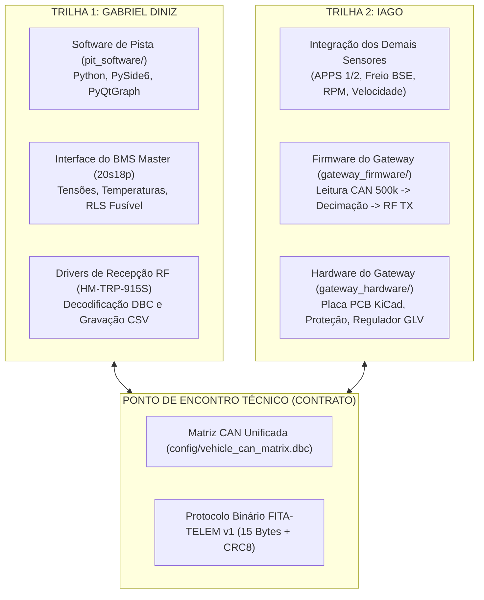

# Arquitetura de Integração & Guia Mestre de Desenvolvimento
**Formula ITA — Formula SAE Electric (Temporada 2025-2026)**
**Autores & Mantenedores:** Gabriel Diniz & Iago

---

## 1. Visão Geral e Separação de Responsabilidades

Este documento estabelece o alinhamento de engenharia para o desenvolvimento da Telemetria e sua integração com os sistemas do veículo (especialmente o **BMS Master**, a **VCU** e o **Inversor**).

Como o desenvolvimento é realizado por duas pessoas trabalhando em paralelo em suas próprias máquinas, o repositório é dividido em duas trilhas independentes, cujo ponto de contato é a **Matriz CAN Oficial** (`config/vehicle_can_matrix.dbc`):



---

## 2. A Fronteira Crítica: BMS Master vs. Telemetria

Uma das regras mandatórias do regulamento da Formula SAE Electric (EV4.8 / EV8) é que **a segurança do veículo reside 100% no hardware e no firmware do BMS Master**. A telemetria é estritamente um sistema passivo de monitoramento (sniffer).

```
   [BMS 5S Slaves] 
          │  (Barramento Iso-SPI diferencial com isolação galvânica >= 2500 Vrms)
          ▼
   [BMS Master (Nucleo-G474RE)]
          │  (Se houver falha de subtensão, sobretensão ou temperatura:
          │   o BMS Master ABRE a linha de Shutdown (SDC) e desliga os AIRs)
          │
          │  (Barramento CAN Veicular a 500 kbps: Pino CAN_H e CAN_L)
          ▼
   [Barramento CAN do Veículo] ◄─── [VCU / Pedais / Inversor]
          │
          ▼
   [Módulo de Telemetria (Gateway)]  <-- Placa do Iago
          │  (Lê os frames CAN a 500 kbps, filtra taxa e transmite via RF 915 MHz)
          ▼
   [Notebook no Box da Pista]       <-- Software do Gabriel
          (Plota gráficos a 30 FPS, calcula RLS, alerta engenheiros de pista)
```

> **Regra de Ouro:**
> * O **BMS Master NÃO precisa saber que existe telemetria ou rádio**. Ele apenas publica seus dados no barramento CAN.
> * A **Telemetria NÃO envia comandos de segurança**. Ela apenas lê o barramento CAN e transmite para a pista.

---

## 3. Roteiro Passo a Passo: O que Fazer Quando Chegarem as Placas do BMS?

Atualmente as placas físicas do BMS Master (Carrier Shield com ST NUCLEO-G474RE) e dos módulos escravos BMS 5S Slaves ainda não estão montadas. Quando os componentes e placas chegarem da fábrica, siga este **checklist rígido de comissionamento de bancada**:

### Passo 1: Comissionamento Inicial dos Módulos Escravos (BMS 5S Slaves)
1. **NÃO conecte células de lítio reais na bancada nos primeiros testes!** Use um divisor resistivo (5 resistores de $1\ \text{k}\Omega$ $1\%$ em série alimentados por uma fonte DC de bancada ajustada em $18{,}0\text{ V}$, simulando 5 células de $3{,}60\text{ V}$).
2. Meça com o multímetro os pinos de entrada analógica de cada canal do conector para garantir que nenhuma tensão ultrapasse $4{,}5\text{ V}$.
3. Verifique com osciloscópio os pulsos diferenciais do transformador de pulso Iso-SPI (`Pulse HMU2103NL`).

### Passo 2: Comissionamento do BMS Master (NUCLEO-G474RE)
1. Conecte a NUCLEO-G474RE no computador via cabo USB ST-Link.
2. No repositório [`BMS Master - STM - V0`](../BMS%20Master%20-%20STM%20-%20V0/), compile e grave o firmware C99 oficial via STM32CubeIDE ou Makefile.
3. Conecte o cabo Iso-SPI de 2 fios trançados entre a porta Iso-SPI do Master e o primeiro BMS 5S Slave.
4. **Verificação da CAN com Osciloscópio ou Sniffer:**
   * Meça os pinos `CAN_H` e `CAN_L` da saída do transceptor isolado `TI ISO1042` da placa master.
   * Deve haver atividade de transmissão a **500 kbps** com nível recessivo em $2{,}5\text{ V}$ e dominante com abertura de $CAN_H \approx 3{,}5\text{ V}$ e $CAN_L \approx 1{,}5\text{ V}$.
   * Certifique-se de que há um resistor de terminação de **$120\ \Omega$** instalado entre `CAN_H` e `CAN_L`.

### Passo 3: Integração Física entre BMS Master e Telemetria
1. Conecte o pino `CAN_H` do BMS Master ao pino `CAN_H` do módulo de telemetria (`SN65HVD230`).
2. Conecte o pino `CAN_L` do BMS Master ao pino `CAN_L` do módulo de telemetria.
3. Ligue o terra de sinal (`GND`) de baixa tensão (GLV).
4. No software de pista do Gabriel (`pit_software`), selecione a porta serial do receptor `HM-TRP-915S` e conecte.
5. **Resultado Imediato:** As tensões reais medidas pelos escravos e calculadas pelo G474RE aparecerão instantaneamente na tela do computador no box!

---

## 4. O Contrato de Dados: Matriz CAN Unificada (`vehicle_can_matrix.dbc`)

O arquivo [`config/vehicle_can_matrix.dbc`](../config/vehicle_can_matrix.dbc) é o contrato imutável entre os dois desenvolvedores:

### 4.1 Faixa de IDs do BMS Master (Gabriel Diniz)
| CAN ID (Hex) | CAN ID (Dec) | Nome da Mensagem | Período Nominal | Descrição |
| :---: | :---: | :--- | :---: | :--- |
| `0x100` | 256 | `BMS_Heartbeat_Status` | 50 ms | Estado FSM, SDC armado, AIRs, flags de falha |
| `0x101` | 257 | `BMS_Pack_Metrics` | 20 ms | Tensão total (V), Corrente (A), SOC (%), SOH (%) |
| `0x102` | 258 | `BMS_Dynamic_Limits` | 50 ms | Limites DCL e CCL dinâmicos para o inversor |
| `0x103` | 259 | `BMS_Extremes_MinMax` | 50 ms | V_min, V_max (com IDs das células), T_min, T_max |
| `0x110` | 272 | `BMS_CellVoltages_Group1` | 100 ms | Tensões das células 01 a 04 (mV) |
| `0x111` | 273 | `BMS_CellVoltages_Group2` | 100 ms | Tensões das células 05 a 08 (mV) |
| `0x112` | 274 | `BMS_CellVoltages_Group3` | 100 ms | Tensões das células 09 a 12 (mV) |
| `0x113` | 275 | `BMS_CellVoltages_Group4` | 100 ms | Tensões das células 13 a 16 (mV) |
| `0x114` | 276 | `BMS_CellVoltages_Group5` | 100 ms | Tensões das células 17 a 20 (mV) |
| `0x120` | 288 | `BMS_Temperatures` | 100 ms | Temperaturas dos 4 módulos escravos (°C) |
| `0x130` | 304 | `BMS_Diagnostics_Fuse` | 200 ms | Diagnóstico RLS de fusível rompido e Z-score |

### 4.2 Faixa de IDs dos Demais Sensores e VCU (Iago)
| CAN ID (Hex) | CAN ID (Dec) | Nome da Mensagem | Período Nominal | Descrição |
| :---: | :---: | :--- | :---: | :--- |
| `0x200` | 512 | `VCU_Driver_Sensors` | 50 ms | APPS1/2 (%), Pressão Freio BSE (bar), Velocidade (km/h), Esterçamento (°) |
| `0x201` | 513 | `INV_Motor_Telemetry` | 50 ms | RPM do Motor, Torque Comando (Nm), Temp Motor (°C), Temp IGBT (°C) |
| `0x202` | 514 | `VCU_Suspension_Travel` | 50 ms | *(Reservado para sensores de curso de amortecedor)* |
| `0x203` | 515 | `VCU_Wheel_Speeds` | 20 ms | *(Reservado para encoders das 4 rodas / controle de tração)* |

> **Para o Iago:** Qualquer novo sensor veicular adicionado ao carro no futuro deve ser cadastrado como sinal dentro desta faixa de IDs no arquivo `vehicle_can_matrix.dbc`. O gateway o transmitirá automaticamente.

---

## 5. Como Trabalhar em Paralelo nas Máquinas de Cada Um

### 5.1 Como o Gabriel trabalha (Trilha 1: Software de Pista)
1. O Gabriel pode trabalhar **mesmo sem nenhum hardware ou rádio plugado no notebook**.
2. Basta rodar o software de pista (`python main.py` ou duplo clique em `run.bat` dentro de `pit_software/`).
3. O software possui um **Modo Simulação Virtual** (`simulator/vehicle_simulator.py`) que gera dinamicamente todo o ciclo de corrida FSAE, acelerações, frenagens, aquecimento térmico e injeção de faltas interativas.
4. O Gabriel aprimora os gráficos, layout, cálculo de métricas de telemetria e o visual sem depender do carro.

### 5.2 Como o Iago trabalha (Trilha 2: Gateway Firmware e Hardware)
1. O Iago trabalha na pasta `gateway_firmware/` gravando o código no microcontrolador (ESP32 via PlatformIO ou Arduino IDE).
2. Liga o transceptor `SN65HVD230` aos pinos da MCU (`GPIO 5 = TX`, `GPIO 4 = RX`, `3.3V` e `GND`) e o rádio `HM-TRP-915S` na porta serial (`GPIO 17 = TX`, `GPIO 16 = RX`, `ENABLE = GND`, `VCC = 3.3V`).
3. O Iago pode testar o envio de frames usando outro nó CAN ou enviando mensagens de teste e verificando a recepção no notebook do Gabriel.

---

## 6. Checklist de Boas Práticas do Git
1. Sempre que alterar ou adicionar sinais CAN, altere primeiro o arquivo mestre: `config/vehicle_can_matrix.dbc`.
2. Não commitar pastas de compilação temporárias (`__pycache__`, `.pio`, arquivos `.log` ou `.csv` de telemetria local). O arquivo `.gitignore` já está configurado para protegê-los.
3. Commits objetivos e em português ou inglês padronizado (`feat(gui): ...`, `fix(gateway): ...`, `docs: ...`).
